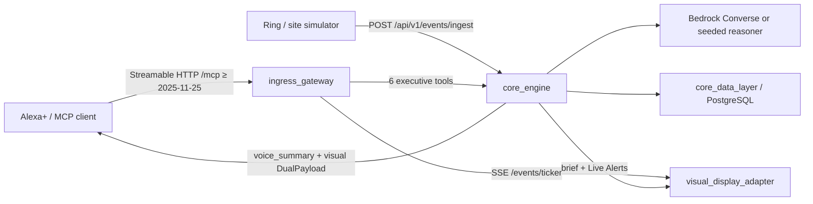

# ExecuTV architecture

ExecuTV is an AI executive workstation: Alexa+ is the voice console, Fire TV is the visual console, and MCP is the tool bus between them.

## Dual-payload contract

Every orchestration result is a **pair**, never voice-only or screen-only:

- **Voice** — short spoken text in `voice_summary`.
- **Visual** — a 10-foot layout (`briefing`, `decision`, `status`, `alerts`, or `audit`) with `highlighted_card_id` set by the handler.

The formatter lives in `apps/core_engine` so Alexa+ and the TV client cannot drift. The ingress gateway only translates MCP tool calls into engine HTTP and fans tool activity out on SSE.

## Runtime topology

| Process | Port | Transport |
| --- | --- | --- |
| `executv_db` (PostgreSQL 16) | 5432 | SQL |
| `core_engine` | 8001 | REST / OpenAPI |
| `ingress_gateway` | 8000 | MCP Streamable HTTP + SSE |
| `visual_display_adapter` | 5173 | HTTPS-less local Vite (Fire TV WebView / browser) |

## Data

PostgreSQL is the system of record. `KPI` / `MetricDriver` feed `explain_metric_change` (Region B margin, 18.3%, drivers −3.1 and −1.1). `DecisionItem` plus `DecisionAuditLog` store the playbook gate, keyed by `session_id`. `WorkflowInstance` / `WorkflowStep` track RFQ Response #12345 and the Q3 close blocked at the Gate 4 physical audit. `operational_events` stores the Gate 4 Ring camera backlog.

Ingress uses MCP Python SDK 2.x `MCPServer.streamable_http_app` (Streamable HTTP). Supported protocol versions include **2025-11-25** and **2026-07-28**. Bedrock Converse sits in `core_engine.llm`. `LLM_PROVIDER=seeded` skips the model. A bearer token, `protocol-version`, and `mcp-session-id` are required on `/mcp`. Production shape is in `infra/`: ECS Fargate, an ALB with a 120s idle timeout, RDS PostgreSQL 15, Secrets Manager, and S3 + CloudFront.

## 10-foot UI constraints

The visual adapter is a TV app, not a desktop SPA:

- Keep all chrome inside a ~5% safe margin.
- Body type stays large enough to read from a couch (~1.3–1.7rem+).
- Focus is keyboard / D-pad first (`:focus-visible` rings, `tabIndex` on tiles).
- The bottom ticker is the glanceable live region for MCP tool activity.
- The right rail is **Live Alerts** (Ring / site / delivery) sourced from `operational_events`.
